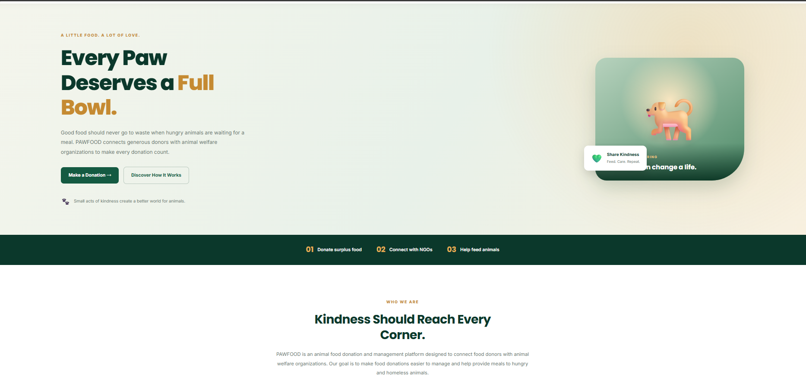
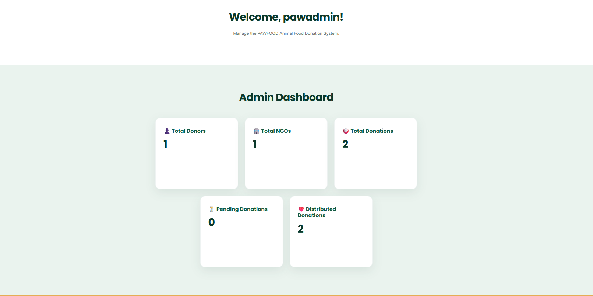
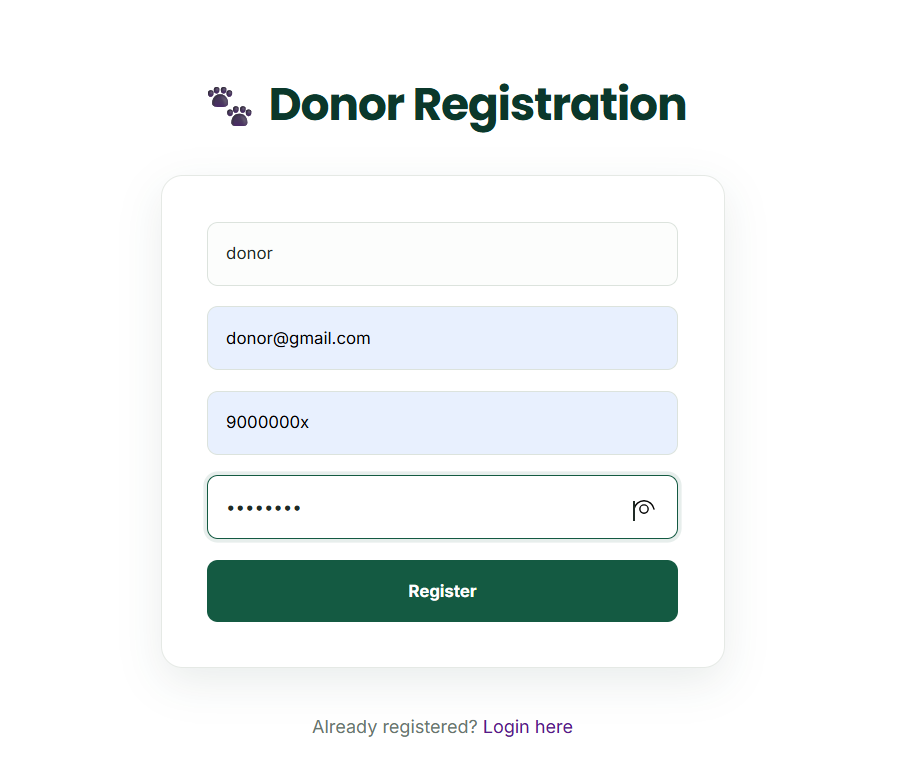
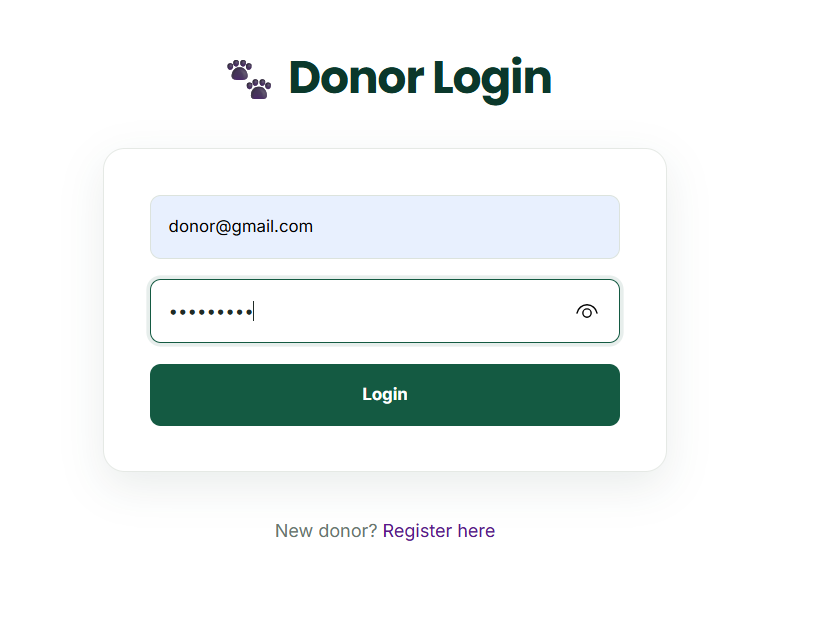
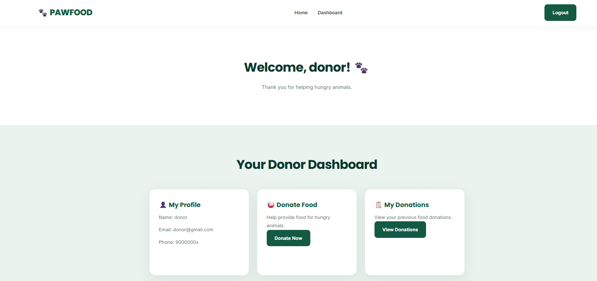
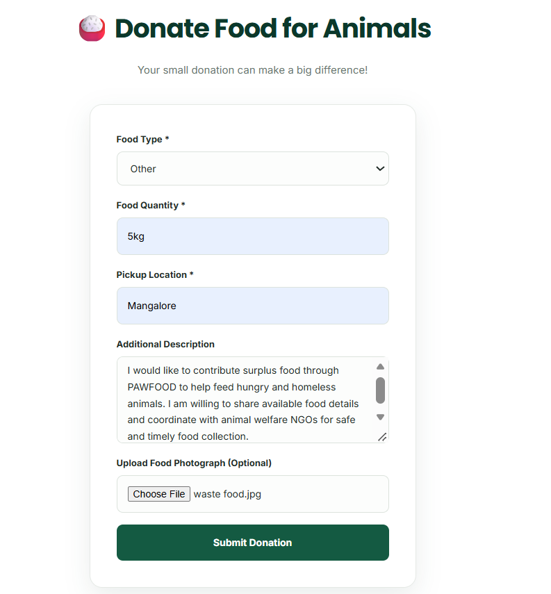
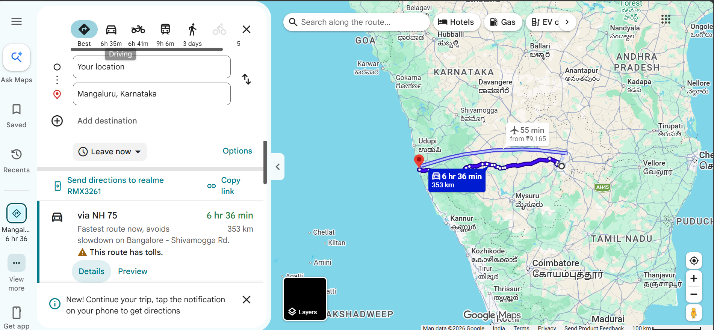
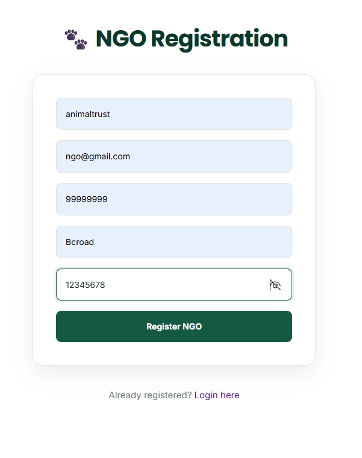
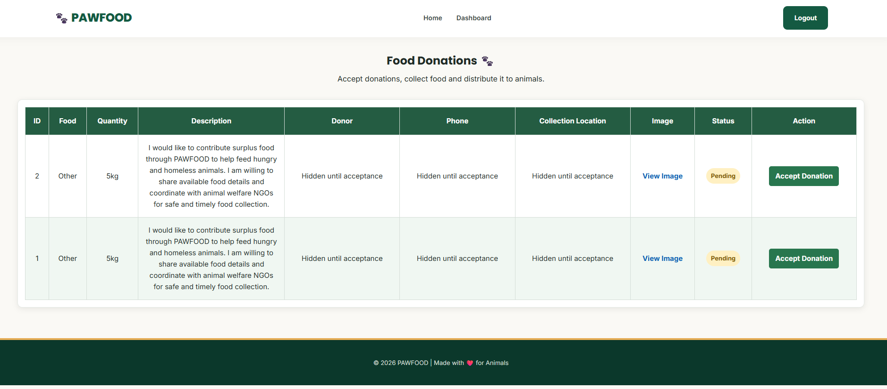

# 🐾 PAWFOOD – Food Donation Platform for Animals

**PAWFOOD** is a web-based food donation management system developed using HTML, CSS, PHP, and MySQL. The platform aims to reduce food wastage by connecting food donors with animal welfare organisations (NGOs).

Instead of throwing away surplus food, donors can share available food details through PAWFOOD. Registered NGOs can view donation information and coordinate food collection to help feed hungry and homeless animals.

The system provides separate dashboards for administrators, donors, and NGOs to make the donation management process more organised and efficient.

## ✨ Features

### 👨‍💼 Admin Module
- Admin Login
- Admin Dashboard
- Manage and monitor platform information
- Manage donor and NGO records
- Monitor food donation details

### ❤️ Donor Module
- Donor Registration
- Secure Donor Login
- Donor Dashboard
- Submit Food Donations
- Upload Food Images
- Provide Food Type, Quantity, Location, and Description
- View Personal Donation History
- Donation Submission Confirmation

### 🏢 NGO Module
- NGO Registration
- NGO Login
- NGO Dashboard
- View Available Food Donations
- Access Food Donation Details
- View Donation Location Information

### 📍 Additional Features
- Food Donation Information
- Location Tracking / Location Details
- Food Image Upload
- Separate User Dashboards
- Session-Based Login Management
- Database-Driven Record Management

## 🛠️ Technologies Used

- **Frontend:** HTML, CSS, JavaScript
- **Backend:** PHP
- **Database:** MySQL
- **Local Server:** Apache (XAMPP)
- **Database Management:** phpMyAdmin

## Project Screenshots

### Home Page


### Admin Dashboard


### Donor Registration


### Donor Login


### Donor Dashboard


### Food Details



### Location Tracking


### NGO Registration


### NGO Dashboard

## 🚀 How to Run the Project

### 1. Install XAMPP

Download and install [XAMPP](https://www.apachefriends.org/).

### 2. Clone the Repository

Open the terminal and execute:

```bash
git clone YOUR_GITHUB_REPOSITORY_URL
```

### 3. Move the Project Folder

Place the downloaded project folder inside the XAMPP `htdocs` directory.

Example:

```text
C:\xampp\htdocs\pawfood
```

### 4. Start XAMPP

Open the XAMPP Control Panel and start:

- Apache
- MySQL

### 5. Create the Database

- Open `http://localhost/phpmyadmin/`
- Create a database named `pawfood_db`.
- Import the project's SQL file, if included in the repository.

### 6. Configure the Database

Open the database configuration file in the project and update the database connection settings according to your local MySQL setup.

**Note:** Do not upload real database passwords or private credentials to GitHub.

### 7. Run the Project

Open your browser and visit:

```text
http://localhost/pawfood/
```

## 🔐 Security Considerations

- Passwords are stored using password hashing.
- Prepared statements are used for database queries.
- Login sessions are used to protect dashboard pages.
- Food image uploads are validated by file type and size.
- Private configuration files and credentials should not be published publicly.

## 🎯 Project Objective

The main objective of PAWFOOD is to reduce food wastage and encourage food donations for animal welfare. It provides a platform where donors and NGOs can connect and coordinate food contributions to support hungry animals.

## 👩‍💻 Developed As

An academic web development project using PHP and MySQL.

## ❤️ Our Mission

**Reduce Food Waste. Feed Hungry Animals. Make Every Meal Count.**

